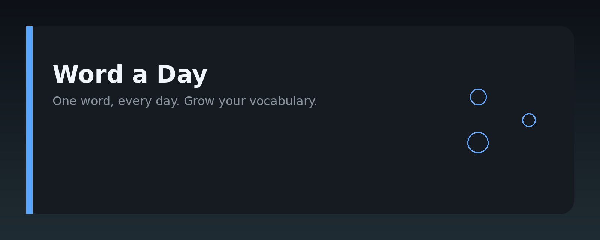
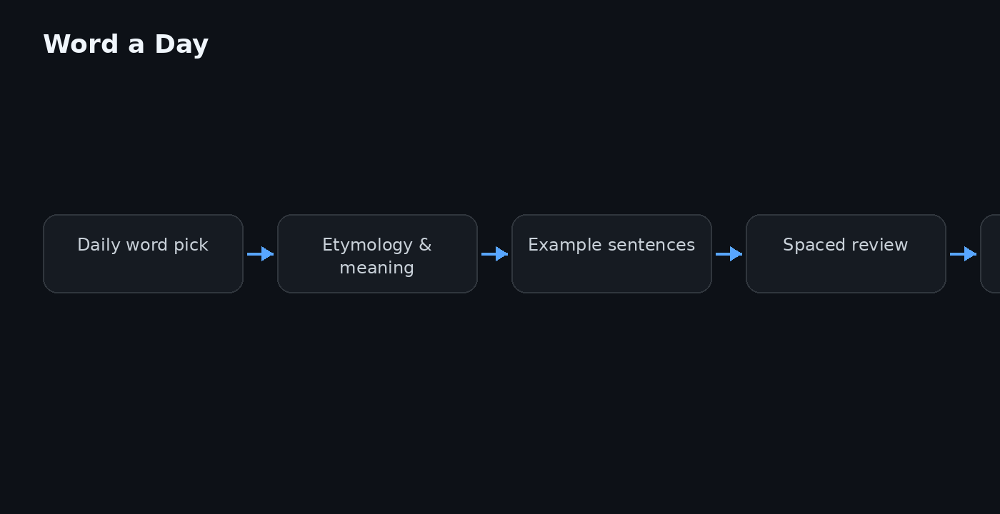

# Word a Day




## Overview

**Word a Day** is a lightweight, self-contained vocabulary-building tool that delivers one curated word per day, complete with definitions, usage examples, etymology, and spaced-repetition prompts. The repository is a documentation and reference guide for the core engine, its data model, and the workflows you can build around daily word exposure.

The project is designed for developers, educators, and language learners who want a predictable, scriptable way to integrate daily vocabulary practice into existing apps, CLI tools, or study routines.

## Why it exists

Most vocabulary apps bury the word of the day behind sign-ups, paywalls, or noisy UIs. Word a Day exists to solve a simpler problem: a clean, deterministic source of daily words that you can trust, extend, and automate. The guide documents how the word selection pipeline works, how to customize the word pool, and how to wire the output into your own notification or review system.

The project also fills a practical gap: it gives you a reproducible baseline for experiments in spaced repetition, lexical frequency analysis, and language learning UX. Instead of scraping random word lists, you get a structured, versioned dataset and a clear contract for how a "day" is defined.

## Core concepts

- **Word entry** – a single record containing the word, part of speech, IPA pronunciation, definition, example sentence, and source tag.
- **Daily seed** – a deterministic seed derived from the date, so every user sees the same word for a given day without needing a server.
- **Word pool** – a curated JSON/CSV list of words with metadata. The pool is versioned and can be extended locally.
- **Review queue** – an optional local state file that tracks which words you have seen, allowing spaced-repetition scheduling on top of the daily pick.
- **Output formats** – the daily word can be emitted as plain text, JSON, or Markdown, making it easy to pipe into other tools.

## Architecture

The system is intentionally simple and follows a linear pipeline:

```
date → seed → pool index → word entry → formatter → output
```

1. **Date source** – reads the current UTC date (or a custom date for testing).
2. **Seed generator** – hashes the date string into a stable integer.
3. **Pool loader** – reads the word pool file (JSON by default) and validates entries.
4. **Selector** – uses the seed to pick an index from the pool (modulo arithmetic).
5. **Formatter** – renders the selected entry into the requested output format.
6. **Sink** – writes to stdout, a file, or a callback function.

The architecture keeps all logic pure and testable. No network calls, no databases, and no external dependencies are required for the core path.

## Practical workflow

A typical daily routine looks like this:

1. **Pull the repo** or install the package in your environment.
2. **Run the daily command** (e.g., `word-a-day --format json`) to get today's word.
3. **Feed the output** into your notification system, study app, or terminal prompt.
4. **Log the word** in your local review queue if you plan to revisit it later.
5. **Extend the pool** by adding new entries to the JSON file, then re-run to verify the selection still works.
6. **Automate** with a cron job or scheduler to run the command every morning.

For testing or demos, you can pass a custom date to simulate any day of the year.

## Examples

Get today's word as plain text:

```bash
word-a-day
```

Get today's word as JSON:

```bash
word-a-day --format json
```

Simulate a specific date:

```bash
word-a-day --date 2025-06-15
```

Use the Python API in your own script:

```python
from word_a_day import get_daily_word

entry = get_daily_word(date="2025-06-15")
print(entry.word)
print(entry.definition)
```

Add a custom word to the pool:

```json
{
  "word": "serendipity",
  "pos": "noun",
  "ipa": "/ˌserənˈdɪpəti/",
  "definition": "the occurrence of events by chance in a happy or beneficial way",
  "example": "Finding that old letter was pure serendipity.",
  "source": "user-added"
}
```

## FAQ

**Q: Is an internet connection required?**  
No. The core pipeline is fully offline. Only the optional notification integrations would need network access.

**Q: How is the daily word chosen?**  
A deterministic hash of the date selects an index from the word pool. The same date always yields the same word, which makes testing and coordination easy.

**Q: Can I use my own word list?**  
Yes. Replace or extend the pool file with your own entries. Keep the required fields (word, pos, definition) intact.

**Q: What if the pool changes mid-day?**  
The selection is based on the date and the pool size at runtime. If you add or remove words, the mapping for that day may change. For stable results, version your pool file.

**Q: Does this support spaced repetition?**  
The core project provides the daily word and a review queue structure, but the scheduling logic is left to you. The guide includes examples of how to integrate it with a simple interval tracker.

**Q: What output formats are supported?**  
Plain text, JSON, and Markdown. The formatter is pluggable, so adding a new format is a small change.

## License MIT

This project is licensed under the MIT License. You are free to use, modify, and distribute it, provided you include the original copyright and permission notice. See the `LICENSE` file in the repository root for the full text.

Topic: `word-a-day-vocabulary`
